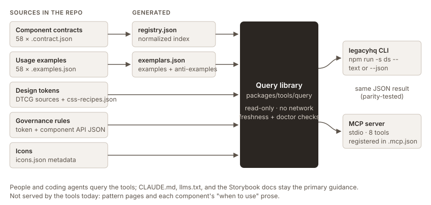

# Case study: a CLI and MCP server for the LegacyHQ design system

Material for a portfolio case study. Every number here comes from the repo or from the
benchmark run in [REPORT.md](REPORT.md); nothing is projected.

## The problem

Coding agents working in this repo have to find the right component, prop, or token among 58
components and several hundred tokens, and follow governance rules spread over JSON files and
Storybook pages. The docs are thorough (`CLAUDE.md`, `llms.txt`, per-component contracts and
examples, generated `registry.json` and `exemplars.json`), but answering one question can mean
reading several large files. The aim was to let an agent ask for one fact and get an exact,
current answer, and then to measure whether that helps.

## What was built



Four packages, each its own pull request, merged before the next began:

| Package | What | PR |
|---|---|---|
| CLI-01 | A shared, read-only query library over the data the repo already generates: components, examples, tokens (DTCG), governance rules, icons, and a freshness check. No second registry. | #50 |
| CLI-02 | `legacyhq`, the library on the command line, with `--json` on every command and a `doctor` check. | #51 |
| MCP-01 | A local stdio MCP server with eight read-only tools, each a thin wrapper over one library function, registered in a committed `.mcp.json`. | #52 |
| MCP-02 | This benchmark: three tasks, three conditions, scored against the repo. | this PR |

Design decisions that held up:

- **One library, two front ends.** The CLI's `--json` output and each MCP tool's structured
  result are the same object, and tests assert it for every tool, errors included.
- **Answers from the source of truth.** The library imports the generators' build functions and
  the token pipeline rather than re-reading formats, so it can't drift from what the build makes.
- **Errors that help.** A lookup that misses returns close matches (`buton` → `button`); filter
  values are enums read from the schema and data.
- **Nothing writes.** No tool edits files, runs the build, or uses the network.

### The CLI

```text
$ npm run -s ds -- tokens search raised --tier semantic
--color-elevation-shadow-raised-default    color  semantic  dark, light
--color-elevation-shadow-raised-inner      color  semantic  dark, light
--color-elevation-shadow-raised-perimeter  color  semantic  dark, light
--color-elevation-shadow-raised-spread     color  semantic  dark, light
--color-elevation-surface-raised-default   color  semantic  dark, light
--color-elevation-surface-raised-hover     color  semantic  dark, light
--color-elevation-surface-raised-press     color  semantic  dark, light
7 tokens.

$ npm run -s ds -- components get buton
legacyhq: No component "buton".
Did you mean: button?
```

### The MCP server

From the benchmark's MCP run on the pattern task, the agent's first calls:

```text
search_components  form                 → 18 results, Form first
search_components  text input field     → TextField, Slider
get_component      form
get_examples       form
get_component      checkbox / switch / field
```

## How it was measured

Three tasks taken from the repo's own guidance (choose a form control; write CSS with the right
semantic tokens; build a form that follows the Forms and Validation pattern), each run in
headless Claude Code under three conditions: the docs only, the docs plus the CLI, and the docs
plus the MCP server. Same commit, same model (`claude-sonnet-5-5`), same prompt. Every run started
in a fresh copy of the repo with the benchmark's checks removed. A scorer checked each answer for
the documented choices and for anything off-system: invented components, props, or tokens,
primitive tokens, raw values. See [README.md](README.md).

## Results

- All nine runs passed every check, 20 of 20 per condition, with nothing off-system.
- The docs alone were enough for this model on these tasks, so the tools had nothing to fix.
- The CLI condition took the fewest turns (17 in total) and cost least ($0.42); MCP took the
  most (43) and cost most ($0.63); docs alone took 29 turns and $0.46. One run each, so these are
  observations, not effects.
- 6 of 25 MCP searches returned nothing: search needed every word to match, and the agent searched
  for token names that `CLAUDE.md`'s own examples suggest but the system doesn't use.

## What I'd say about it

- The benchmark found no accuracy gain, and the report says so. The useful result is where the
  tools fall short: search that needs exact words, and guidance (patterns, "when to use") the
  tools don't serve, which is what the tasks needed most.
- The run also found a docs bug: `CLAUDE.md` names tokens that don't exist, and agents followed
  them.
- Next: forgiving search with suggestions, a `text` → `content` synonym for tokens, a pattern
  tool, corrected `CLAUDE.md` examples, and a harder, repeated benchmark.

## Limits

One run per task and condition; three tasks; one model. The CLI condition could also read files
through read-only shell commands. All runs loaded the same project memory. Details in
[REPORT.md](REPORT.md).

## Still to add

- Screenshots of the CLI in a terminal and of the MCP tools in Claude Code (`/mcp` and a tool
  call). The text captures above are real output; the images need to be taken on a screen.
